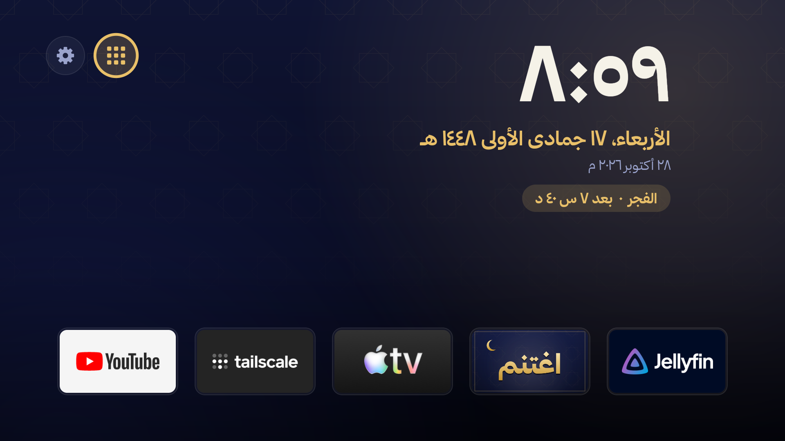

# اغتنم — ساعة الأذان لشاشات Android TV / Google TV

يحوّل شاشتك الذكية إلى ساعة أذان: شاشة توقف بمواقيت الصلاة، وبطاقة أذان صغيرة تطلع فوق أي شي تشاهده، وتذكيرات يوم الجمعة، وشاشة رئيسية عربية خفيفة ونظيفة.

مبني على تطبيق الويب [اغتنم — ساعة الأذان](https://aboumarai.com/ightanam) (الصفحة تشتغل داخل التطبيق).

| الشاشة الرئيسية | شاشة التوقف |
|---|---|
|  |  |

| بطاقة الأذان | تذكير الجمعة |
|---|---|
|  |  |

## المزايا

### 🕌 الأذان والصلاة
- **شاشة توقف:** الساعة، والتاريخ الهجري، والصلاة القادمة، وكم باقي عليها، ومواقيت اليوم، و«أذّن … منذ X د» لمدة نص ساعة بعد الأذان.
- **بطاقة الأذان:** بطاقة صغيرة في زاوية الشاشة وقت الصلاة:
  - توقف الفيديو اللي شغّال، وتشغّل الأذان، وبعدها ترجّع الفيديو من مكانه.
  - زر **رجوع** يوقف الأذان وتكمل مشاهدتك.
  - صوت المؤذن نفس اللي اخترته في الصفحة، وأذان الفجر له صوت خاص.
- **وضع الجمعة:**
  - تذكير سورة الكهف، وزر الوسط يشغّلها.
  - تذكير التبكير قبل الصلاة بساعة وربع.
  - تذكير ساعة الإجابة قبل المغرب بساعة.
- **المواقيت:** أم القرى، وحساب العصر على المذهب الشافعي. المدينة اللي تختارها في الصفحة تنتقل للتطبيق تلقائياً، ولو انقطع الاتصال يحسب المواقيت بنفسه.

### 🏠 الشاشة الرئيسية (اختيارية)
- الوقت والتاريخ الهجري والميلادي، والصلاة القادمة وكم باقي عليها.
- **شريط تطبيقاتك تحت:** أنت تختار وش يكون فيه. لو زادت التطبيقات عن عرض الشاشة يصير الشريط يتحرك بالأسهم.
- **زر كل التطبيقات** (المربعات جنب الإعدادات): يعرض كل التطبيقات المثبتة.
  - **ضغطة مطوّلة على زر الوسط** على أي تطبيق تضيفه للشريط أو تشيله منه، والتطبيقات اللي في الشريط عليها ★.
  - ضغطة مطوّلة على تطبيق في الشريط نفسه تشيله.
- **زر مصادر الإدخال** (جنب كل التطبيقات): يعرض منافذ HDMI ويحوّل لها بضغطة. الموصول منها يطلع بالذهبي، ولو الشاشة تعرف الجهاز (مثل Nintendo Switch أو PlayStation) يطلع اسمه تحت المنفذ.
- زر **رجوع** ما يطلّعك من الشاشة الرئيسية، وزر **Home** يرجّعك لها من أي مكان.
- تصميم داكن بلمسة ذهبية ونقشة إسلامية خفيفة.

### ⚡ تسريع الشاشة
قسنا على شاشة Google TV بمعالج ٤ أنوية وذاكرة ٣ جيجا:

| | قبل | بعد |
|---|---|---|
| ذاكرة الشاشة الرئيسية | شاشة Google مع خدمتها المساعدة: حوالي **١٢٠ ميجا** | «اغتنم» كامل، مع الأذان: حوالي **٤٥–٥٠ ميجا** |
| مدة حركات القوائم | ١× | **٠٫٥×** (نص الوقت) |

- **الشاشة الرئيسية أخف بكثير:** ما فيها اقتراحات ولا معاينات فيديو تتحمّل في الخلفية.
- **تسريع الحركات:** التنقل والانتقالات بين القوائم تصير أسرع بالنص. هذا أكثر شي تحسّه بيدك.
- **تعطيل التطبيقات اللي ما تستخدمها:** تبطل تشتغل في الخلفية وتوفّر ذاكرة. التعطيل يرجع بأمر واحد.
- **إطفاء صوت التنقل** بين الأيقونات.

> هذي تحسينات في سرعة التنقل والذاكرة، ما تغيّر سرعة المعالج نفسه ولا جودة الفيديو.

## التثبيت

فيه ثلاث طرق، اختر الأسهل لك:

### الطريقة ١: خلّ وكيل ذكاء اصطناعي يسويها عنك 🤖

أي وكيل يقدر يشغّل أوامر على جهازك يقدر يركّبه لك، مثل Claude Code أو Codex أو Gemini CLI. الخطوات المكتوبة له موجودة في [AGENTS.md](AGENTS.md)، وهو يسألك قبل أي تغيير.

١. فعّل في الشاشة **خيارات المطوّر** ثم **تصحيح USB**: من **الإعدادات ← النظام ← حول**، اضغط على «إصدار نظام Android TV» ٧ مرات. واعرف عنوان IP حق الشاشة من إعدادات الشبكة.

٢. افتح الوكيل على جهاز متصل بنفس شبكة الشاشة، والصق له هذا:

```text
ثبّت تطبيق اغتنم على شاشتي باتباع التعليمات في
https://github.com/aboumar5/ightanam-tv/blob/main/AGENTS.md
عنوان الشاشة: <اكتب عنوان IP هنا>
اسألني قبل أي تغيير، وقل لي كيف أتراجع عنه.
```

٣. وافق على رسالة «السماح بتصحيح USB» اللي تطلع على الشاشة.

### الطريقة ٢: يدوياً بأوامر adb

تحتاج أداة [adb](https://developer.android.com/tools/releases/platform-tools) على جهازك، وملف التطبيق `ightanam-tv.apk` من [صفحة الإصدارات](https://github.com/aboumar5/ightanam-tv/releases/latest).

١. فعّل **تصحيح USB** في الشاشة (الخطوة ١ في الطريقة الأولى).

٢. اتصل بالشاشة، ووافق على الرسالة اللي تطلع عليها:

```bash
adb connect <TV_IP>:5555
```

٣. ثبّت التطبيق:

```bash
adb install -r ightanam-tv.apk
```

٤. اسمح لبطاقة الأذان تطلع فوق التطبيقات الثانية:

```bash
adb shell appops set com.aboumarai.ightanam SYSTEM_ALERT_WINDOW allow
```

٥. خلّه شاشة التوقف:

```bash
adb shell settings put secure screensaver_components com.aboumarai.ightanam/.IghtanamDream
```

```bash
adb shell settings put secure screensaver_enabled 1
```

٦. افتح «اغتنم» مرة وحدة، واضغط «ابدأ»، واختر مدينتك والمؤذن.

#### تركيب الشاشة الرئيسية

Google TV ما يقبل شاشة رئيسية ثانية إلا إذا عطّلت شاشته. هذا التعطيل يرجع بسهولة، لكن تتوقف معه اقتراحات Google TV. البحث الصوتي والكاست يبقون شغالين.

١. عطّل شاشة Google الرئيسية وشاشة «الإصلاح» اللي تحاول ترجّعها:

```bash
adb shell pm disable-user --user 0 com.google.android.apps.tv.launcherx
```

```bash
adb shell pm disable-user --user 0 com.google.android.tungsten.setupwraith
```

٢. خلّ «اغتنم» هي الشاشة الرئيسية:

```bash
adb shell cmd package set-home-activity com.aboumarai.ightanam/.HomeActivity
```

٣. اضغط زر **Home** في الريموت، ولازم تطلع لك الشاشة الجديدة.

٤. لاختيار تطبيقات الشريط: اضغط زر المربعات جنب الإعدادات، وبعدها ضغطة مطوّلة على زر الوسط على التطبيق اللي تبيه.

**للتراجع:**

```bash
adb shell pm enable com.google.android.apps.tv.launcherx
```

```bash
adb shell pm enable com.google.android.tungsten.setupwraith
```

> ⚠️ لو بتسوي إعادة ضبط المصنع، تراجع قبلها، لأن الإعداد الأول للشاشة يحتاج `setupwraith`.

#### التسريع (اختياري)

تسريع الحركات للنص:

```bash
adb shell settings put global window_animation_scale 0.5
```

```bash
adb shell settings put global transition_animation_scale 0.5
```

```bash
adb shell settings put global animator_duration_scale 0.5
```

إطفاء صوت التنقل بين الأيقونات:

```bash
adb shell settings put system sound_effects_enabled 0
```

تعطيل تطبيق ما تستخدمه (اعرف اسم حزمته من `adb shell pm list packages`):

```bash
adb shell pm disable-user --user 0 <اسم_الحزمة>
```

لإرجاعه:

```bash
adb shell pm enable <اسم_الحزمة>
```

> لا تعطّل تطبيق مداخل HDMI (`com.mediatek.wwtv.tvcenter` في شاشات MediaTek)، ولا الكيبورد اللي تستخدمه، ولا Google Play أو الإعدادات.

#### تجربة الأذان والتذكيرات

```bash
adb shell am broadcast -n com.aboumarai.ightanam/.AdhanReceiver --ez test true --es key asr
```

```bash
adb shell am broadcast -n com.aboumarai.ightanam/.AdhanReceiver --ez test true --es friday kahf
```

### الطريقة ٣: ابنِه بنفسك (Windows)

يُبنى بدون Gradle، باستخدام أدوات Android SDK مباشرة. تحتاج:

- **Android SDK** فيه `build-tools\35.0.0` و`platforms\android-35`، في `%LOCALAPPDATA%\Android\Sdk`.
- **JDK 17:** عرّف `JAVA_HOME` أو حطه في `%USERPROFILE%\dev\jdk17`.
- **خط ثمانية (اختياري):** ترخيصه يمنع إعادة توزيع ملفاته، عشان كذا مب موجود في المستودع، ولا في ملف APK الجاهز. نزّله من [font.thmanyah.com](https://font.thmanyah.com) وحط ملفات `.otf` في مجلد `fonts`. لو ما حطيته، التطبيق يستخدم خط النظام.

```powershell
.\build.ps1
```

الناتج: `ightanam-tv.apk`، موقّع بمفتاح debug. بعدها كمّل من الخطوة ٢ في الطريقة الثانية.

## 🔒 بعد ما تخلص

اقفل **تصحيح USB** من خيارات المطوّر، وألغِ تصاريح التصحيح. كذا ما يقدر أي جهاز ثاني على الشبكة يتحكم بشاشتك.

## الملفات

| الملف | وظيفته |
|---|---|
| `Web.java` | يفتح صفحة الويب، ويرتّب واجهتها للريموت، ويجيب منها المدينة والمؤذن والمواقيت |
| `IghtanamDream.java` | شاشة التوقف |
| `AdhanScheduler.java` / `PrayerTimes.java` | منبّه الصلاة القادمة، وحساب المواقيت لو ما فيه اتصال |
| `AdhanReceiver.java` / `AdhanService.java` | بطاقة الأذان وتذكيرات الجمعة اللي تطلع فوق المشاهدة |
| `FridayScheduler.java` | مواعيد تذكيرات الجمعة |
| `HomeActivity.java` | الشاشة الرئيسية، وشاشة كل التطبيقات، واختيار تطبيقات الشريط |
| `art.ps1` | يرسم أيقونة التطبيق وشعاره |
| `AGENTS.md` | تعليمات التثبيت لوكلاء الذكاء الاصطناعي |

## الترخيص

الكود تحت رخصة MIT، وتفاصيلها في ملف [LICENSE](LICENSE). خط ثمانية له ترخيصه الخاص من شركة ثمانية، ومب مشمول هنا.
